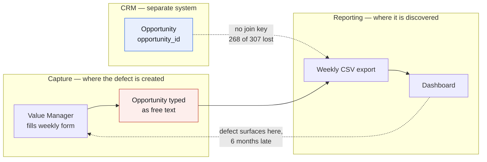
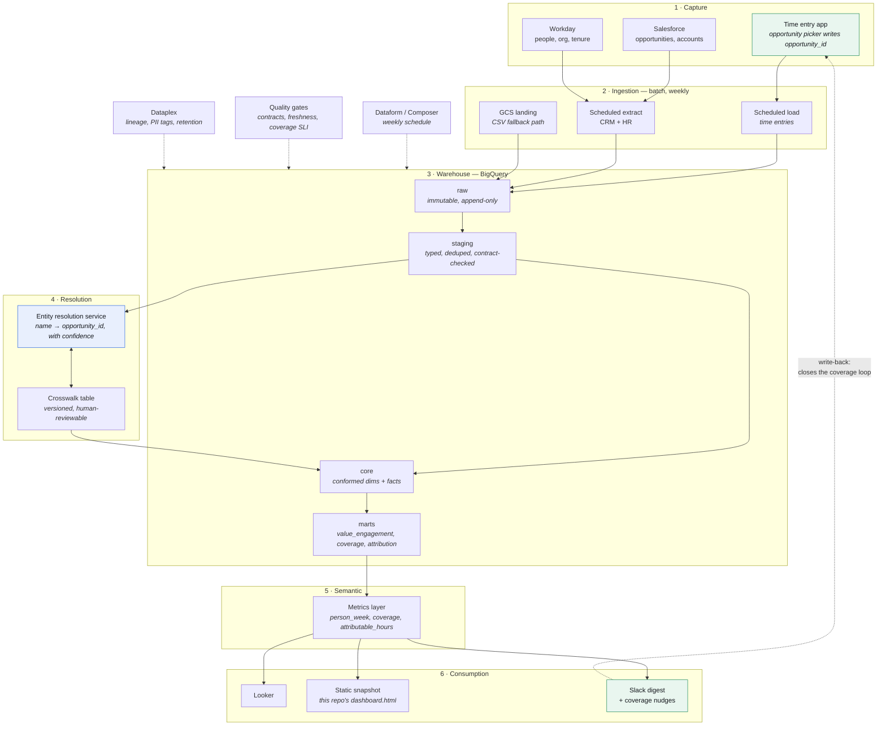
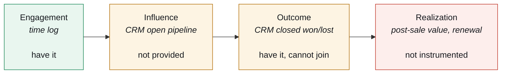

# Target-state design: from a time log to a value-realization system

The dashboard in this repository answers the question as asked. This document
is the part I think matters more: **the dashboard proves the problem is not in
the reporting layer.**

Half the question leadership asked — *what does the investment produce* — is
unanswerable today, and no amount of better charting fixes it. 0.4% of logged
hours can be traced to a closed deal; 16 of the 307 opportunities the team
worked on could be matched to the CRM at all. Not because the analysis is weak,
but because a person types an opportunity *name* into a form while the CRM
stores an *id*. That is a business-process defect that happens months upstream
of any dashboard, and it can only be fixed where the data is created.

So this is a design for the process, not the report.

---

## 1. Where the defect actually is

Five structural consequences, all visible in the data:

| Observed in the data | Root cause | Layer that must fix it |
|---|---|---|
| 16 of 307 opportunities matchable | No join key at capture | Capture |
| 38.8% of time in one undifferentiated bucket | Form has no sub-activity | Capture |
| 72% reporting coverage, 25%–100% by person | No feedback loop to the person | Process |
| Column names drift between exports | No data contract | Integration |
| Fiscal calendar had to be *inferred* | No conformed date dimension | Modelling |

Everything below follows from that table. Each component exists to close one
row of it — nothing is in the design because it is standard.

---

## 2. Sizing this honestly first

The entire dataset is 2,701 rows — about 110 a week, roughly 1,300 a quarter,
covering six months and 25 people. **This is not a big-data problem**, and
proposing a streaming lakehouse for it would be the wrong answer dressed up as
a sophisticated one. Even at ten times the headcount it would fit in a
spreadsheet.

The architecture below is deliberately sized to the problem, and I have marked
what I would *not* build yet:

- **Not building:** streaming ingestion, a feature store, real-time anything.
  The business cadence is weekly, so the diagram above is batch end to end —
  scheduled loads, a weekly orchestration trigger, no message bus. An earlier
  draft drew Pub/Sub and an event-driven trigger while the text argued for
  batch; the picture was contradicting the argument.
- **Not building:** a separate data lake tier. BigQuery is the lake and the
  warehouse at this volume.
- **Am building:** entity resolution, data contracts, a semantic layer, and a
  write-back loop — because those address the five root causes above, and none
  of them are about volume.

The cost of the target state is dominated by licences the company already owns,
not compute. At this scale BigQuery sits comfortably in the free tier for
storage and query.

---

## 3. Target architecture

### The four decisions that carry the design

**1 · Fix capture, then everything else gets cheap.**
Replacing the free-text opportunity field with a picker that writes
`opportunity_id` is a two-week change to one form. It converts attribution from
an inference problem that recovers 5% of opportunities — 0.4% of hours — into
a foreign key. Every other component in this diagram gets simpler because of
it. If leadership funds exactly one thing, this is the one, and the dashboard
exists partly to make that case with a number rather than an opinion.

**2 · Entity resolution is a service with memory, not a script.**
The name matcher in `pipeline.py` is the prototype, and its history is the
argument for building this properly. A third tier matched on deal value and
tripled the hit rate; it turned out to be a coincidence detector, because 93%
of CRM amounts are already unique, and it linked unrelated companies. It was
removed. Promoted to the target state, entity resolution becomes a persistent
crosswalk that (a) stores a confidence score and the method behind each match,
(b) is versioned so a restated match does not silently rewrite history, and
(c) routes anything below a high threshold to a human queue instead of
counting it. A rule that improves the number on its own authority is exactly
what this layer exists to prevent.
History is never re-matched silently — a corrected mapping is a new version
with an effective date, so last quarter's board pack still reproduces.

**3 · A data contract on the export, enforced in CI.**
Two columns were renamed between the only two exports provided: `Opportunity
Name` became `OpportunityName`, and `HoursTotal` became `Hours Total`. The
loader in this repo absorbs that defensively, which is correct for a take-home
and wrong as a permanent posture — it means breakage is silent. In the target
state the export has a declared schema; a contract test runs on arrival; a
breaking change fails the pipeline loudly and notifies the owning team rather
than quietly producing a thinner number.

**4 · One definition of every metric, in the semantic layer.**
"Person-week", "reporting coverage" and "attributable hours" are defined once
and consumed by Looker, the Slack digest and the static snapshot alike. The
alternative — each surface reimplementing them — is how an organisation ends up
with three different answers to "how much time did we spend on X" and stops
trusting all of them.

---

## 4. Widening the process: time is one leg of a four-leg question

The brief asked where time goes and what it produces. "What it produces" is not
a time-log question at all — it spans four systems the team does not own:

| Leg | Source | Status today | What it unlocks |
|---|---|---|---|
| Engagement | Time log | Available, 72% coverage | Where effort goes |
| Influence | CRM open pipeline | **Not in the pack** — only closed deals were provided | Work in flight, not post-mortems |
| Outcome | CRM closed | Provided, unjoinable | Win rate on touched vs untouched deals |
| Realization | Post-sale, renewals | Not instrumented | Whether the value case was actually delivered |

A Value *Management* function is ultimately judged on the fourth leg: did the
value we promised in the business case materialise after signature. Nothing in
the current data model can see it. The architecture above is laid out so that
leg can be added as a source without restructuring anything — it is a new fact
table against the same conformed account and opportunity dimensions.

**The measurement trap, stated explicitly:** even with a perfect join, hours on
a won deal do not mean the hours caused the win. Value Managers are
preferentially assigned to large, strategic, already-promising deals. Any
honest attribution needs a control — comparable untouched opportunities matched
on segment, deal size and type — otherwise the function will report a flattering
number that is pure selection effect. I would build that comparison in from the
start, because it is much harder to introduce after leadership has seen the
flattering version.

---

## 5. Delivery path

Sequenced so each phase produces something usable on its own, and the riskiest
dependency (a change to someone else's form) is bought with evidence from the
phase before it.

| Phase | Scope | Outcome | Depends on |
|---|---|---|---|
| **0 · Now** | This repo | Leadership sees the real picture, including what is unanswerable. Builds the case for phase 2. | Nothing |
| **1 · Weeks 1–4** | Land all three sources in BigQuery; contract tests; conformed date and org dimensions; dbt models | One source of truth; fiscal calendar becomes a fact, not an inference; drift fails loudly | Access |
| **2 · Weeks 4–10** | **Opportunity picker in the time form**; entity-resolution service and crosswalk; backfill history with confidence scores | Attribution on new data goes from 0.4% of hours to near-complete; history gets a defensible, scored best effort | Form owner — the political dependency, not a technical one |
| **3 · Weeks 8–14** | Semantic layer; Looker; coverage SLI with Slack write-back | Metrics agree everywhere; coverage becomes an operational number with an owner, not a caveat | Phase 1 |
| **4 · Quarter 2** | Open pipeline + post-sale realization sources; matched-control attribution model | The question the function is actually judged on becomes answerable, with a control group | Phase 2 |

Phase 2 is the one that matters, and its real risk is organisational: it
requires another team to change a form. That is why phase 0 ships first and
leads with the 0.4% figure — the number is the business case.

---

## 6. What I would monitor

Pipelines fail quietly; data quality fails *loudly in meetings, six months
later*. These are service levels, with owners, not dashboard decorations:

| Signal | Threshold | Why it matters |
|---|---|---|
| Reporting coverage | ≥ 90% of person-weeks filed | Currently 72%. Every total understates reality until this moves. |
| Attribution rate | ≥ 95% of opportunity hours carry a valid id | The headline defect: 0.4% today. Post-phase-2 this should be near 100%. |
| Catch-all concentration | No single activity above 15% of logged hours | Digital Experience Management is at 38.8%, which is what a bucket looks like when it has become a dumping ground. A rising number means the taxonomy stopped fitting the work. |
| Schema contract | 0 unannounced changes | Two renamed columns across the only two exports provided. |
| Freshness | Export landed by Tuesday 09:00 | Defines when the weekly number is trustworthy. |
| Crosswalk confidence | ≤ 5% of matched value from low-confidence tiers | Stops silent degradation of the attribution number over time. |

The last one is the one most teams miss. An entity-resolution layer degrades
gradually and invisibly; without monitoring the confidence mix, the attribution
number stays plausible long after it stopped being true.

---

## 7. What I would push back on

Three things I would raise before building, because a design that only lists
what it will deliver is not a design:

1. **Do not fund a Looker rebuild before fixing capture.** It produces a more
   beautiful version of a number that still cannot be connected to an outcome,
   and it spends the budget that phase 2 needs.
2. **Do not publish per-person hour comparisons.** Reporting behaviour varies by
   a factor of three across this team; any ranking measures form-filling, not
   contribution. Publishing one would also degrade the data, because people log
   differently once they know they are being ranked — which is the fastest way
   to destroy the asset being built.
3. **Do not let "value realized" be self-reported by the team being measured.**
   It needs to come from the customer-facing system of record, or it is
   marketing rather than measurement.
